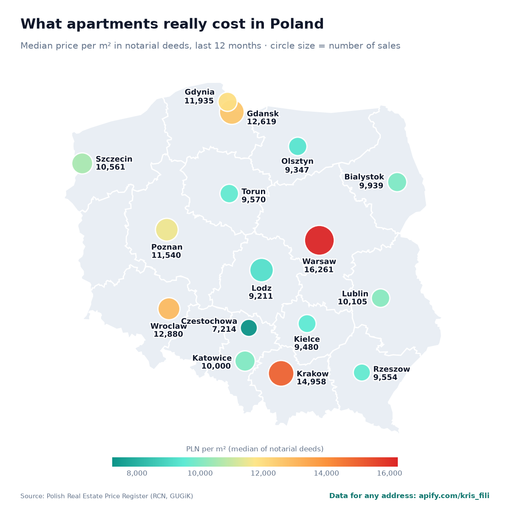
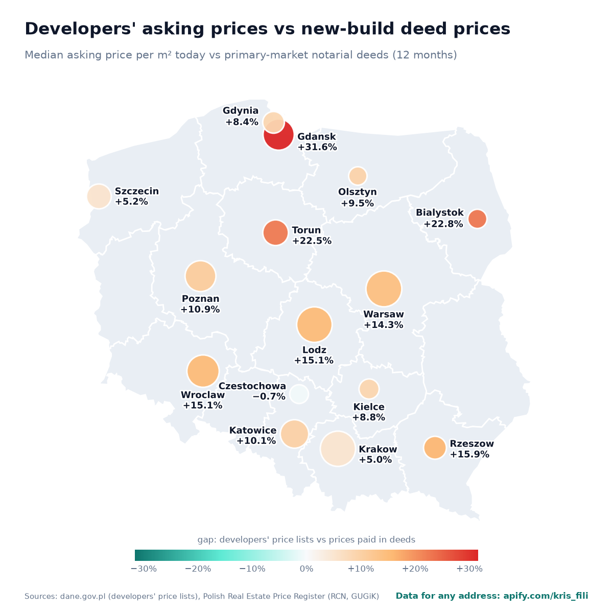

# Poland housing prices – official notarial deed data, updated weekly

What apartments **really sell for** in Poland's largest cities: the median price per m² from notarial deeds in the official Real Estate Price Register (*Rejestr Cen Nieruchomości*, RCN), compared with developers' asking prices from the price lists they must publish daily on dane.gov.pl. An automated pipeline refreshes this repository every week.

In November 2026, the median apartment sold in **Warsaw** went for **16,261 PLN per m²**, in **Czestochowa** for **7,214 PLN** – according to notarial deeds, not listings.



## Latest numbers (2026-11-09)

| City | Median deed price (PLN/m²) | Year on year | New-build deeds | Resale deeds | Developers' asking price | Asking vs new-build deeds | Deeds up to |
|---|---:|---:|---:|---:|---:|---:|---|
| Warsaw | 16,261 | +6.2% | 16,093 | 16,480 | 17,300 | +7.5% | August 2026 |
| Krakow | 14,958 | +3.5% | 15,015 | 14,841 | 15,773 | +5.0% | September 2026 |
| Wroclaw | 12,880 | +3.3% | 13,083 | 12,703 | 15,070 | +15.2% | August 2026 |
| Gdansk | 12,619 | +6.4% | 11,927 | 13,111 | 15,693 | +31.6% | January 2026 |
| Gdynia | 11,935 | +2.7% | 12,362 | 11,691 | 13,400 | +8.4% | June 2026 |
| Poznan | 11,540 | +3.5% | 11,798 | 11,358 | 13,197 | +11.9% | September 2026 |
| Szczecin | 10,561 | +9.0% | 11,383 | 9,674 | 12,120 | +6.5% | September 2026 |
| Lublin | 10,105 | +0.3% | 10,143 | 10,105 | 11,220 | – | September 2026 |
| Katowice | 10,000 | +0.7% | 11,336 | 8,163 | 12,500 | +10.3% | September 2026 |
| Bialystok | 9,939 | +4.8% | 10,132 | 9,744 | 12,500 | +23.4% | October 2026 |
| Torun | 9,570 | +8.2% | 10,100 | 8,969 | 12,375 | +22.5% | June 2026 |
| Rzeszow | 9,554 | – | 9,327 | 10,625 | 10,800 | +15.8% | October 2026 |
| Kielce | 9,480 | +5.1% | 10,300 | 8,697 | 11,150 | +8.3% | June 2026 |
| Olsztyn | 9,347 | +8.1% | 9,588 | 9,116 | 10,825 | +12.9% | August 2026 |
| Lodz | 9,211 | – | 10,000 | 7,798 | 11,554 | +15.5% | September 2026 |
| Czestochowa | 7,214 | +1.4% | 8,354 | 6,110 | 8,300 | −0.6% | September 2026 |



## Data files

- [`data/cities.csv`](data/cities.csv) – the latest table (median, quartiles, primary vs resale, year on year, developers' asking prices and the gap)
- [`data/history/`](data/history) – a snapshot every week, so the time series grows over time

## Data for a specific address

The same official sources, for any address in Poland, through ready-made APIs (Apify Actors – also usable without code, with Excel/CSV export):

- [Transaction prices from notarial deeds](https://apify.com/kris_fili/poland-real-estate-transaction-prices) – median, quartiles, trend and the list of deeds around any address
- [Apartment valuation (AVM)](https://apify.com/kris_fili/poland-apartment-valuation) – an estimated value for any apartment from comparable deeds
- [New-build prices](https://apify.com/kris_fili/poland-new-build-apartment-prices) – every developer offer around an address
- [Asking vs transaction price gap](https://apify.com/kris_fili/poland-housing-price-gap) – both sources compared for any location

## Use it from an AI assistant (MCP)

Add this remote MCP server to Claude, ChatGPT, Cursor or any other MCP client – it gives the assistant the four tools above (on first use you sign in with an Apify account, free tier available):

```json
{
  "mcpServers": {
    "poland-housing": {
      "url": "https://mcp.apify.com?tools=kris_fili/poland-apartment-valuation,kris_fili/poland-real-estate-transaction-prices,kris_fili/poland-new-build-apartment-prices,kris_fili/poland-housing-price-gap"
    }
  }
}
```

Then ask, for example: *"How much is a 54 m² two-room flat at Długa 12 in Kraków worth? Use notarial deed prices."*

Prefer a local server (stdio, `uvx`)? See [poland-housing-mcp](https://github.com/yngzty4229-art/poland-housing-mcp).

## Methodology

- **Deeds:** apartment sales from the RCN register (GUGiK bulk export + live web service), market sales of full ownership only, implausible prices and outliers removed.
- **12-month window** ending at the latest deed published for each city – counties publish with different delays (see the last column).
- **Year on year:** median of the last 12 months vs the 12 months before, shown only when both periods have comparable coverage.
- **Asking prices:** available apartments in developers' official daily price lists, whole city.
- New-build deeds are often signed at handover, so they reflect older price lists – part of the gap is timing.

## Sources and license

Source data: Rejestr Cen Nieruchomości – Główny Urząd Geodezji i Kartografii (public register, free since 13 Feb 2026); developers' price lists – dane.gov.pl. Voivodeship borders: PRG (GUGiK). The tables and maps in this repository are licensed under [CC BY 4.0](https://creativecommons.org/licenses/by/4.0/) – please credit "Poland housing prices, github.com/yngzty4229-art/poland-housing-prices".

---

### Po polsku

**Ceny transakcyjne mieszkań w największych miastach Polski – z aktów notarialnych, aktualizowane co tydzień.** Mediana ceny za m² z Rejestru Cen Nieruchomości (RCN) w 17 miastach, rynek pierwotny i wtórny, zmiana rok do roku oraz ceny ofertowe z cenników deweloperów (dane.gov.pl) i różnica między nimi. Dane w pliku [`data/cities.csv`](data/cities.csv), co tydzień nowy zrzut w [`data/history/`](data/history). Dane dla konkretnego adresu i wycena mieszkania: [apify.com/kris_fili](https://apify.com/kris_fili).
